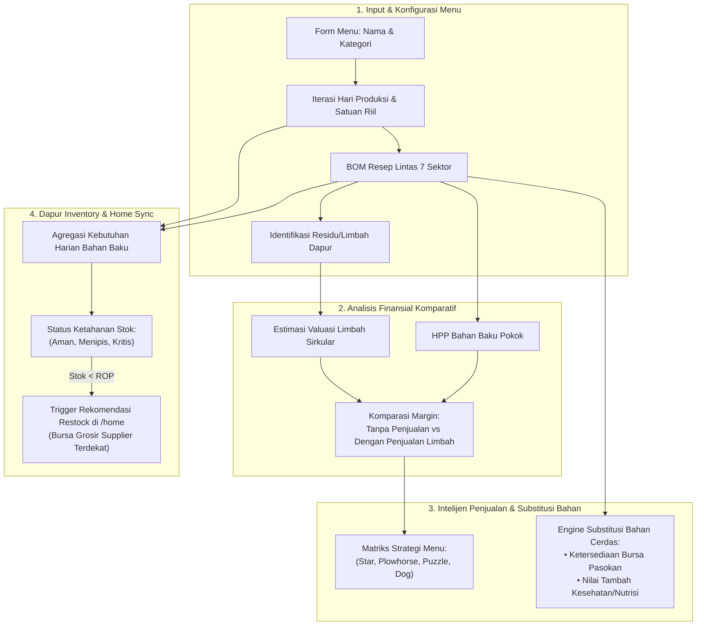

# Briefing Rekayasa UI/UX: Manajemen Menu, Margin Sirkular Komparatif, Stok Dapur & Strategi Bahan Cerdas

Dokumen ini merinci arsitektur antarmuka dan alur kerja (*workflow*) mutakhir untuk modul **Menu & Resep UMKM** pada ekosistem KUMPUL. Pembaruan ini mencakup penyesuaian ritme produksi harian, perbandingan margin finansial (dengan vs tanpa penjualan limbah), inventaris bahan baku dapur yang terhubung ke Beranda (*Home*), strategi penekanan menu (*Menu Engineering*), hingga rekomendasi alternatif bahan berbasis ketersediaan pasar dan kesehatan.

---

## 1. Arsitektur Alur Sistem Terpadu



---

## 2. Refaktor Form Penambahan Menu: Iterasi Produksi & Satuan Baru

### 2.1. Konsep "Iterasi Hari Produksi"
Alih-alih menggunakan istilah statis *"Target Batch"*, sistem beralih ke pendekatan operasional nyata UMKM:
* **Iterasi Produksi Harian (Frekuensi/Hari)**: Berapa kali proses masak/produksi diulang dalam satu hari kerja (misal: 1 sesi pagi, 1 sesi sore = `2 Iterasi/Hari`).
* **Kapasitas Output per Iterasi**: Jumlah porsi atau unit yang dihasilkan dalam satu putaran produksi (misal: `50 Porsi/Iterasi`).
* **Total Output Harian Otomatis**:
  $$\text{Output Harian} = \text{Frekuensi Iterasi/Hari} \times \text{Kapasitas per Iterasi}$$

### 2.2. Standardisasi Opsi Satuan Riil UMKM
Pilihan satuan produk jadi diperluas dan disesuaikan dengan berbagai model bisnis UMKM:

| Satuan | Deskripsi Penggunaan | Contoh Sektor/Produk |
| :--- | :--- | :--- |
| `PORSI` | Piring / Sajian standar siap santap | Warung makan, resto, kedai |
| `BOWL` | Mangkuk kertas/plastik modern | Rice bowl, salad, dessert kekinian |
| `BOX` | Kotak bento, nasi kotak katering | Katering harian, pesanan kantor |
| `CUP` | Gelas minuman dingin/panas | Kopi susu, boba, teh artisan |
| `PAX` | Paket rombongan/buffet | Katering prasmanan, tumpeng mini |
| `BOTOL` | Kemasan cairan (250ml - 1000ml) | Minuman herbal, jamu, saus, cold brew |
| `LOYANG` | Cetakan panggangan/kukus | Kue bolu, roti, pie, brownies |
| `BUNGKUS` | Tradisional (daun pisang/kertas) | Nasi uduk bungkus, lemper, jajanan pasar |
| `PACK` | Pouch/plastik segel sealer | Keripik, camilan kering, bumbu racik |
| `PCS` | Satuan lepasan umum | Gorengan, donat, dimsum |
| `KG` | Penjualan curah/timbangan | Daging olahan kiloan, frozen food |

---

## 3. Card Menu Dinamis, Edit Langsung & Komparasi Margin Limbah

### 3.1. Fitur Edit Langsung (*Inline / Modal Edit*)
Setiap kartu menu pada grid produk dilengkapi tombol **Edit Menu**. Saat ditekan, modal konfigurasi langsung terbuka dengan data terisi (*pre-filled*), memungkinkan pemilik UMKM untuk:
* Mengubah takaran resep dan harga beli bahan baku sewaktu-waktu saat harga pasar fluktuatif.
* Menyesuaikan target iterasi hari produksi sesuai permintaan musiman (misal: peningkatan saat akhir pekan).
* Memperbarui estimasi timbulan limbah.

### 3.2. Komparasi Margin: Tanpa Penjualan Limbah vs. Dengan Penjualan Limbah
Kartu menu menyajikan tabel/kartu komparasi finansial berdampingan (*side-by-side*) yang membuktikan keuntungan ekonomi sirkular:

```
┌─────────────────────────────────────────────────────────────────────────────────────────────────┐
│ 🍗 Bebek Goreng Kremes Sambal Korek                             [Kategori: Makanan Utama]       │
│ 2 Iterasi / Hari • 50 Porsi per Iterasi (Total Output: 100 Porsi / Hari)    [ Tombol: ✏️ Edit ] │
├─────────────────────────────────────────────────────────────────────────────────────────────────┤
│ 📊 ANALISIS MARGIN FINANSIAL KOMPARATIF                                                         │
│                                                                                                 │
│  Metrik Finansial          │ Skenario A: Konvensional       │ Skenario B: Sirkular KUMPUL      │
│                            │ (Tanpa Penjualan Limbah)       │ (Dengan Penjualan Limbah)        │
│ ───────────────────────────┼────────────────────────────────┼───────────────────────────────── │
│  Harga Jual per Porsi      │ Rp 30.000                      │ Rp 30.000                       │
│  HPP Bahan Pokok per Porsi │ Rp 18.500                      │ Rp 18.500                       │
│  Pendapatan Limbah (Residu)│ Rp 0                           │ +Rp 1.800 / Porsi                │
│  Laba Bersih per Porsi     │ Rp 11.500                      │ Rp 13.300                       │
│  Margin Keuntungan (%)     │ 38.3%                          │ 44.3%  (▲ +6.0% Sirkular Boost)  │
├─────────────────────────────────────────────────────────────────────────────────────────────────┤
│ ♻️ PREDIKSI TIMBULAN LIMBAH PER HARI (100 Porsi):                                              │
│  • Minyak Jelantah (UCO): 2.5 Liter/Hari  ───> Potensi Serap Bursa: Rp 20.000 / Hari           │
│  • Tulang & Residu Daging: 4.0 Kg/Hari    ───> Potensi Pakan Ternak: Rp 8.000 / Hari            │
│  Total Tambahan Cashflow Limbah: Rp 28.000 / Hari (Rp 840.000 / Bulan)                         │
│  [ Tombol: 🚀 Daftarkan Limbah Hari Ini ke Bursa Sirkular ]                                    │
└─────────────────────────────────────────────────────────────────────────────────────────────────┘
```

> [!NOTE]
> **Formula Perhitungan Uplift Margin**:
> $$\text{Margin Murni (\%)} = \frac{\text{Harga Jual} - \text{HPP}}{\text{Harga Jual}} \times 100$$
> $$\text{Margin Ter-Boost (\%)} = \frac{(\text{Harga Jual} - \text{HPP}) + \text{Nilai Limbah per Porsi}}{\text{Harga Jual}} \times 100$$
> **Sirkular Boost** $=\text{Margin Ter-Boost} - \text{Margin Murni}$

---

## 4. Modul Pengolahan Stok Bahan Baku Dapur (Kitchen Inventory Section)

Ditempatkan tepat di bawah grid kartu menu, modul ini mengakumulasi seluruh kebutuhan bahan baku dari semua menu aktif dan mencocokkannya dengan stok fisik dapur.

### 4.1. Tampilan Grid Stok & Ambang Batas Ketahanan
```
┌──────────────────────────────────────────────────────────────────────────────────────────────────┐
│ 📦 PENGOLAHAN STOK BAHAN BAKU DAPUR (AGREGAT RESEP)                           [ + Input Opname ] │
│ Pantau ketersediaan bahan terhadap laju produksi harian dan sinkronkan pengadaan ke Bursa.        │
├──────────────────────────────────────────────────────────────────────────────────────────────────┤
│ Bahan Baku    │ Sektor Asal  │ Kebutuhan Harian │ Stok Dapur │ Ketahanan   │ Status   │ Aksi     │
├───────────────┼──────────────┼──────────────────┼────────────┼─────────────┼──────────┼──────────┤
│ Daging Bebek  │ Peternakan   │ 25.0 Ekor / Hari │ 18.0 Ekor  │ 0.7 Hari    │ 🔴 KRITIS│ [Restock]│
│ Minyak Sawit  │ F&B Olahan   │ 6.0 Liter / Hari │ 8.0 Liter  │ 1.3 Hari    │ 🟡 MENIPIS│ [Restock]│
│ Beras Pandan  │ Pertanian    │ 15.0 Kg / Hari   │ 75.0 Kg    │ 5.0 Hari    │ 🟢 AMAN  │ [Kelola] │
│ Cabai Rawit   │ Pertanian    │ 4.0 Kg / Hari    │ 3.5 Kg     │ 0.8 Hari    │ 🔴 KRITIS│ [Restock]│
│ Paper Box     │ Ritel        │ 100 Pcs / Hari   │ 420 Pcs    │ 4.2 Hari    │ 🟢 AMAN  │ [Kelola] │
└──────────────────────────────────────────────────────────────────────────────────────────────────┘
```

### 4.2. Pengaruh Reaktif ke Rekomendasi di Beranda (`/home`)
Saat stok bahan berstatus **🔴 KRITIS** ($\le 1.0\text{ hari}$) atau **🟡 MENIPIS** ($1.1 - 2.5\text{ hari}$):
1. **Urutan Teratas di Beranda**: Komoditas terkait langsung diposisikan pada slot nomor 1 di modul [`HomeRecommendationSection`](file:///C:/Users/User/Documents/Projekan/KUMPUL/fe/modules/home/home-recommendation-section.tsx).
2. **Badge Peringatan Khusus**:
   * `⚠️ Stok Kritis Dapur (Sisa 0.7 Hari Produksi) • Kebutuhan Bebek Goreng`.
3. **Kalkulasi Rekomendasi Kuantitas**:
   * Sistem secara otomatis menghitung saran kuantitas beli untuk mengamankan ketahanan stok 7 hari ke depan dengan mempertimbangkan harga grosir (*price tiers*) di bursa supplier.

---

## 5. Fitur Baru: Strategi Penjualan Menu (*Menu Engineering Matrix*)

Apakah mungkin memberikan rekomendasi strategi penjualan mana yang harus ditekankan? **Sangat mungkin dan krusial.** 

Sistem mengadopsi prinsip **Menu Engineering Matrix** berbasis profitabilitas margin dan efisiensi rantai pasok bursa:

```
                              PROFITABILITAS MARGIN
                         Rendah                     Tinggi
                   ┌─────────────────────────┬─────────────────────────┐
          Melimpah │     🐎 PLOWHORSE        │        ⭐ STAR          │
                   │ (Tingkatkan Margin)     │ (FOKUS UTAMA PROMOSI)   │
KETERSEDIAAN       ├─────────────────────────┼─────────────────────────┤
PASOKAN            │        🐕 DOG           │       🧩 PUZZLE         │
          Langka / │ (Reformulasi Resep)     │ (Dorong Volume / Menu)  │
          Fluktuatif│                         │                         │
                   └─────────────────────────┴─────────────────────────┘
```

### 5.1. Klasifikasi & Rekomendasi Aksi Nyata

1. ⭐ **Menu Bintang (Star - Margin Tinggi & Bahan Baku Melimpah)**:
   * **Karakteristik**: Margin bersih $>40\%$, pasokan bahan di bursa KUMPUL stabil dan murah.
   * **Rekomendasi Strategi**: **"PUSH PENJUALAN UTAMA"**. Jadikan banner promo teratas di etalase, jadikan paket *bundling*, dan pasang iklan media sosial.
2. 🐎 **Menu Kuda Beban (Plowhorse - Permintaan Tinggi, Margin Pas-pasan)**:
   * **Karakteristik**: Bahan baku mudah didapat, namun margin $<25\%$.
   * **Rekomendasi Strategi**: **"OPTIMASI BIAYA BAHAN"**. Dorong UMKM membeli pasokan via *pooling order* grosir di Bursa KUMPUL untuk menekan HPP 10-15%, atau naikkan harga jual bertahap sebesar 5%.
3. 🧩 **Menu Teka-Teki (Puzzle - Margin Sangat Tinggi, Bahan Rentan/Terbatas)**:
   * **Karakteristik**: Margin besar ($>50\%$), namun volume penjualan moderat atau bahan musiman.
   * **Rekomendasi Strategi**: **"UPSELLING & MENU EKSKLUSIF"**. Tawarkan sebagai *limited-time special* atau menu signature mingguan.
4. 🐕 **Menu Beban (Dog - Margin Rendah & Bahan Sering Langka/Mahal)**:
   * **Karakteristik**: Margin tipis ($<15\%$) dan bahan baku sering melonjak di pasar.
   * **Rekomendasi Strategi**: **"REFORMULASI ATAU GANTI"**. Pertimbangkan untuk merevisi komposisi resep menggunakan bahan alternatif (lihat Seksi 6) atau menghapus menu dari katalog.

---

## 6. Fitur Baru: Rekomendasi Alternatif Bahan Baku Cerdas

Sistem memberikan saran substitusi bahan baku berbasis dua pilar: **Kondisi Pasar Riil** dan **Nilai Tambah Kesehatan**.

### 6.1. Alternatif Berdasarkan Ketersediaan Pasar (*Market Availability & Price Surge*)
Ketika algoritma mendeteksi kenaikan harga bahan pokok $\ge 20\%$ atau kelangkaan musiman di Bursa Komoditas KUMPUL, sistem memunculkan banner rekomendasi alternatif pada kartu menu:

| Bahan Baku Pokok | Masalah Pasar Terdeteksi | Rekomendasi Bahan Alternatif Bursa | Manfaat bagi UMKM |
| :--- | :--- | :--- | :--- |
| **Cabai Rawit Segar** | Harga melonjak drastis (panen gagal) | **Pasta Cabai Fermentasi / Cabai Kering Giling** | Memangkas biaya hingga 35%, masa simpan lebih lama (zero waste). |
| **Daging Sapi Segar** | Keterbatasan kuota & harga impor tinggi | **Daging Ayam Petelur Afkir / Jamur Tiram Olahan** | Alternatif tekstur serat mirip, menstabilkan HPP menu rendang/gulai. |
| **Minyak Goreng Sawit** | Fluktuasi harga bursa tinggi | **Minyak Kelapa Sawit Curah CP8 Terstandarisasi** | Pembelian jeriken konsolidasi KUMPUL dengan harga flat grosir. |

### 6.2. Alternatif Berdasarkan Segi Kesehatan & Nilai Tambah (*Health & Wellness Upgrade*)
Untuk membantu UMKM menyasar segmen konsumen kelas menengah atas yang peduli kesehatan:

| Bahan Standar | Alternatif Lebih Sehat | Aspek Kesehatan & Diferensiasi Pasar | Potensi Peningkatan Harga Jual |
| :--- | :--- | :--- | :--- |
| **Tepung Terigu Impor** | **Tepung MOCAF Lokal (Singkong Modifikasi)** | *Gluten-Free*, ramah lambung, indeks glikemik lebih rendah, mendukung petani lokal. | Menu dapat dijual dengan label *"Bebas Gluten"* (+15% - 25% harga jual). |
| **Minyak Sawit Jenuh** | **Minyak Kelapa Murni (VCO) / Canola** | Mengurangi kolesterol jahat (LDL), aroma lebih harum dan tidak cepat gosong. | Label *"Rendah Lemak Jenuh / Healthy Frying"*. |
| **Gula Pasir Rafinasi** | **Gula Aren Organik Cair / Gula Singkong Cair** | Indeks glikemik rendah (Low GI), rasa manis lebih kaya dan legit alami. | Label *"Low Sugar / Natural Coconut Sugar"*. |
| **Penyedap Sintetis (MSG)** | **Kaldu Jamur Tiram Alami / Bubuk Ikan Teri** | Kaya asam amino bebas alami (alami umami), tanpa bahan pengawet kimia. | Label *"Non-MSG Dapur Alami"*. |

---

## 7. Desain Tipe Data TypeScript (Extended Schema)

```typescript
// Sektor UMKM
export type SectorType =
  | "PERTANIAN"
  | "PETERNAKAN"
  | "PERIKANAN"
  | "PERKEBUNAN"
  | "FNB_PENGOLAHAN"
  | "RITEL"
  | "LOGISTIK";

// Rekomendasi Substitusi Bahan Baku
export interface IngredientAlternativeSuggestion {
  originalIngredientName: string;
  suggestedIngredientName: string;
  category: "MARKET_AVAILABILITY" | "HEALTH_WELLNESS";
  reason: string;
  estimatedCostImpactPercentage: number; // Misal: -25% (hemat) atau +10% (premium)
  healthBadges?: string[];              // ["Gluten-Free", "Low-GI", "Non-MSG"]
}

// Strategi Menu Engineering
export interface MenuEngineeringInsight {
  classification: "STAR" | "PLOWHORSE" | "PUZZLE" | "DOG";
  recommendedAction: string;
  actionPriority: "HIGH" | "MEDIUM" | "LOW";
  marketingTip: string;
}

// Residu Limbah
export interface ProductWasteItem {
  id?: string;
  wasteName: string;
  volumePerIteration: number;
  unit: "KG" | "LITER" | "PCS";
  potentialPricePerUnit: number;
}

// Bahan Baku BOM
export interface ProductRecipeIngredient {
  id?: string;
  name: string;
  sector: SectorType;
  amountPerUnit: number;
  unit: string;
  estimatedCost: number;
  alternative?: IngredientAlternativeSuggestion;
}

// Entitas Produk Lengkap
export interface EnhancedProduct {
  id: string;
  product_name: string;
  menu_category: string;
  unit: string; // PORSI, BOWL, BOX, CUP, dll.
  target_selling_price_per_unit: number;
  
  // Parameter Siklus Harian
  production_iterations_per_day: number;
  units_per_iteration: number;
  
  // Finansial
  calculated_hpp_per_unit: number;
  projected_pure_margin_percentage: number;
  waste_revenue_per_unit: number;
  projected_circular_margin_percentage: number;
  circular_margin_boost: number;
  
  recipes: ProductRecipeIngredient[];
  wastes: ProductWasteItem[];
  strategy?: MenuEngineeringInsight;
}

// Agregat Stok Dapur
export interface KitchenStockItem {
  ingredientName: string;
  sector: SectorType;
  dailyConsumption: number;
  unit: string;
  currentStock: number;
  daysRemaining: number;
  status: "KRITIS" | "MENIPIS" | "AMAN";
  linkedProductsCount: number;
}
```

---

## 8. Checklist Rencana Kerja & Validasi Implementasi

- [ ] **1. Form Dialog Tambah & Edit (`modules/umkm/menu/menu-add-dialog.tsx`)**
  - [ ] Ganti batch kaku dengan `Iterasi Hari Produksi` dan `Kapasitas per Iterasi`.
  - [ ] Update daftar satuan ke 11 opsi riil UMKM.
  - [ ] Tambahkan pemilihan 7 sektor pada baris bahan resep.
  - [ ] Tambahkan konfigurasi limbah dan kalkulasi estimasi penjualan limbah.
  - [ ] Lengkapi mode Edit dengan fungsi binding data yang sudah ada.
- [ ] **2. Komponen Kartu Menu (`modules/umkm/menu/menu-card.tsx`)**
  - [ ] Pasang tombol `Edit Menu` dengan trigger modal edit.
  - [ ] Tampilkan komparasi 2 skenario margin: Murni vs Sirkular (+Boost %).
  - [ ] Munculkan badge status strategi menu (*⭐ Star*, *🐎 Plowhorse*, dll.).
  - [ ] Sediakan accordion rekomendasi bahan alternatif sehat & pasar.
- [ ] **3. Modul Stok Dapur (`modules/umkm/menu/kitchen-inventory-section.tsx`)**
  - [ ] Buat tabel agregasi stok bahan dapur di bawah daftar menu.
  - [ ] Hitung otomatis laju konsumsi harian dan hari ketahanan stok.
  - [ ] Tambahkan tombol penyesuaian stok cepat (*Stok Opname*).
- [ ] **4. Konektor Rekomendasi Home (`modules/home/home-recommendation-section.tsx`)**
  - [ ] Hubungkan status stok kritis dengan bursa komoditas supplier.
  - [ ] Munculkan banner `⚠️ Stok Kritis Dapur` pada rekomendasi belanja utama di beranda.